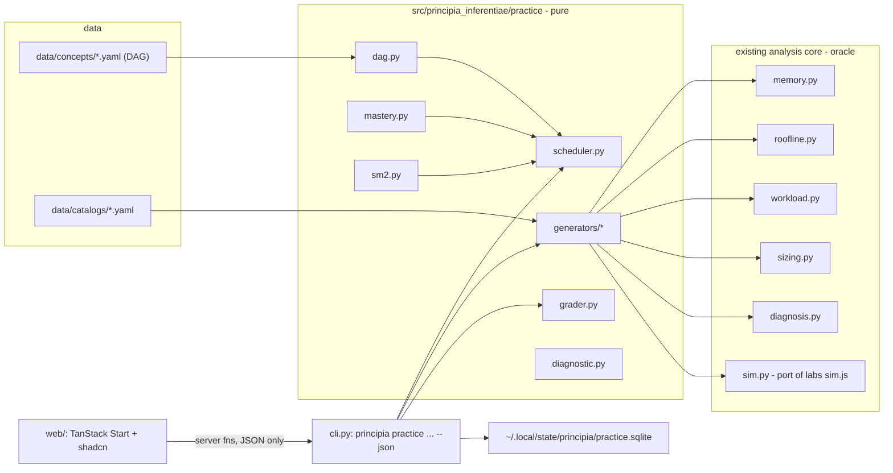

# Plan: a Mathua-style practice engine for inference engineering

Status: PROPOSED (2026-10-22). Not started. Nothing in this file is implemented.

Reference implementation studied: [chuma-beep/mathua](https://github.com/chuma-beep/mathua)
(MIT, Go). Concept DAG → mastery state machine → SM-2 → priority scheduler → parameterised
generators → self-checking graders. Algorithms are small (DAG + machine + SM-2 + scheduler is
roughly 600 lines of Go); the 1,238 commits are content.

## Why this does not exist yet, and why it can now

Mathua works because math has four properties:

| Property | Math | Inference engineering today |
|---|---|---|
| Hard prerequisite DAG | Yes, well known | Shallow and partly contested, but the quantitative core is strictly ordered (units → bytes → KV → fit → phases → metrics → roofline → sizing → diagnosis) |
| Computable ground truth per concept | Number or expression | Exists for the quantitative core: `estimate_memory`, `analyze_roofline`, `characterize_workload`, `size_deployment`, `diagnose_incident` in `src/principia_inferentiae/` already are the oracle |
| Cheap grader | Numeric / SymPy | Numeric with units and tolerance; enum classification; ordering; sim-graded intervention |
| Speed as a mastery signal | Essential | Only for fluency concepts (unit conversion, bytes-per-token mental math). Replace with no-reference reproduction and instance variety, which is what `ai-infra-module-approach` already calls mastery |

The blocker was never the algorithms. It was the oracle. Principia already has one for the
analysis core and `labs/*/sim.js` has one for scheduling-policy judgment (admission, queue,
chunked prefill, retry storm, goodput, prefix, priority, hog, fragmentation, speculative,
evict, LoRA, scale, batch). What is missing is the layer Mathua provides: DAG, generators,
graders, student model, scheduler, delivery.

## Decision: build inside `principia-inferentiae`, do not fork Mathua

- Generators must call the Python authority. A Go fork needs a Go↔Python bridge for every
  question.
- Mathua carries auth, leagues, XP, Postgres, share links. None of that is wanted here.
- Port the four algorithms to Python with attribution in `THIRD_PARTY_NOTICES.md`
  (MIT permits it). Do not port content.

Boundary rule, consistent with `AGENTS.md` ("all time ... must arrive through inputs"):

- `src/principia_inferentiae/practice/` is pure. Every function takes `now_utc`,
  `rng_seed`, and `state` as arguments. No clock, no filesystem, no network.
- Only `cli.py` reads `datetime.now()`, loads/saves the state file, and seeds the RNG.
- Generators never compute an answer. They build typed inputs (`ModelSpec`, `ServingConfig`,
  `RooflineMeasurement`, trace tuples) and ask the existing analysis functions. If the authority
  returns `insufficient_evidence`, that is the answer the learner must give.



## Concept schema

`data/concepts/<domain>.yaml`, validated by a pydantic model in `practice/dag.py`
(mirrors Mathua's `internal/concepts/concepts.go`, with `avg_time_seconds` optional):

```yaml
- id: kv.bytes_per_token
  label: Logical KV bytes per token
  domain: kv_cache
  subdomain: kv_cache.capacity
  grading_type: numeric_units        # numeric_units | choice | classify | order | intervene | formula
  prerequisites: [units.bytes_prefixes, model.attention_heads_vs_kv_heads]
  key_prerequisites: [model.attention_heads_vs_kv_heads]
  encompasses: []
  interference_group: kv_vs_weights  # kv bytes vs weight bytes get confused
  mastery_threshold:
    evidence_floor: 6                # attempts in window
    streak: 5
    avg_time_seconds: null           # null = untimed
  ledger_evidence_id: e-kv-prefix    # optional link to the competency ledger
  knowledge_page: knowledge/kv-cache.md#theory
```

Graph rules (port `scripts/validate_graph.go` as `tests/test_concept_graph.py`): acyclic, no
orphan prerequisite ids, every concept has a registered generator, every `knowledge_page`
anchor exists, every `ledger_evidence_id` is in a fixed allowlist.

## Seed DAG (v0: 48 concepts, 9 domains)

Derived from the eight `knowledge/` pages, the course README topics, and the day2–day4 labs.
Counts are targets for v0, not a ceiling.

| Domain | Concepts (ids abbreviated) | Oracle |
|---|---|---|
| units (5) | bytes prefixes GiB vs GB; us/ms/s; TFLOP/s; GB/s; tokens/s vs ms/token inversion | pure arithmetic in generator (allowed: unit algebra is not an analysis conclusion) |
| model_memory (5) | params × bytes/param; quantization metadata bytes; group-size overhead; weight shards per TP; per-rank weight bytes | `memory._parameter_bytes`, `memory._weight_shards` (expose as public) |
| kv_cache (7) | bytes/token formula; MHA/GQA/MQA kv_heads; TP divides heads, PP divides layers; `shard_layers` replicates heads; active tokens = seqs × max seq; per-rank fit incl. reserve + fragmentation + margin; aggregate fits but one rank OOMs | `memory.estimate_memory` |
| phases (6) | prefill ms = tokens × us/token; decode gap = us/token × batch; TTFT = queue + prefill; ITL vs TPOT; chunked prefill trade; disaggregation when | `sim.py` |
| metrics (7) | TTFT/ITL/TPOT/E2E boundaries; per-user vs aggregate TPS; nearest-rank percentile; p50 vs p99 reasoning; goodput under SLO; inference-only vs end-to-end label; Little's law | `workload._percentiles`, `sim.py` |
| workload (5) | prompt vs output distributions kept separate; peak 1 s concurrency; burst vs steady; prefix reuse ratio; tenant mix | `workload.characterize_workload` |
| roofline (5) | arithmetic intensity; ridge point; classify compute/HBM/underfilled/mixed; capacity vs bandwidth distinct; utilization is not saturation | `roofline.analyze_roofline` |
| sizing (4) | service-curve identity fields; memory-fit lower bound only; `recommended_gpu_count: null` when unmatched; benchmark plan as next step | `sizing.size_deployment` |
| diagnosis (4) | hypothesis ranking order; causal gate five steps; correlation vs root cause; which telemetry is missing | `diagnosis.diagnose_incident` |

Phase 3 adds a `policy` domain (admission, queue, chunked prefill, retry storm, goodput,
prefix, priority, sticky, hog, frag, spec, evict, lora, scale, batch) graded by `sim.py`:
the learner picks one repair; correct iff the clock that was bad separates and the other does
not regress, exactly the rule in `labs/day3/sim.js`.

## Grading types

| type | input | verdict |
|---|---|---|
| `numeric_units` | number + unit string | parse unit, convert to canonical, `abs(rel_err) <= tol` (default 2 %, per-concept override) |
| `choice` | one of N | exact; distractors must be real rejected options (Mathua `MultipleChoice` rule) |
| `classify` | one of a fixed enum (`BoundClassification`, `AnalysisStatus`) | exact |
| `order` | permutation of ids | Kendall tau ≥ threshold or exact top-k |
| `intervene` | one repair id | sim re-run: target clock in SLO and other clock not worse |
| `formula` | text | v0: token-set match against canonical form after whitespace/case normalisation; v1: sympy if `grading/requirements.txt` is accepted as an optional extra |

Generator contract (port of Mathua `Registry.Register` self-check): on registration,
`generate(seed=0, difficulty=0.5)` must grade its own answer correct and grade `""` incorrect.
Every numeric generator publishes `facts` so tests recompute the answer from the facts
rather than comparing a string with itself.

## Student model, SM-2, scheduler (straight port)

- States: `UNSEEN → LEARNING → PRACTICING → MASTERED`; `DECAYING` computed at read time
  (≥ 14 days). Status only moves forward.
- Evidence window: last 6 attempts; score from correctness, difficulty served, instance
  variety, and time only when `avg_time_seconds` is set. `MasteryThreshold = 0.6`,
  `MasteryEvidenceFloor = 6`, `NeutralDifficulty = 0.55`.
- SM-2: `q<3 → rep=0, interval=1`; else `rep++`, `ef += 0.1 − (5−q)(0.08 + (5−q)·0.02)`,
  `ef = max(1.3, ef)`, intervals `1 → 6 → round(prev × ef × speed)`, speed ∈ [0.5, 2.0].
- Priority: `0.5·days_since_seen + 0.2·(1−mastery) + 0.3·weakness + 5·decaying
  + 2·encompasses_weak_prereq − 3·same_interference_group_recent`.
- Hard rules: never surface unmet prerequisites; never the same concept twice in a row;
  no two consecutive questions share a subdomain; 70/30 new/review.
- Weakness propagation: miss on `c` adds `w × 0.3` to dependents when `w > 0.3`.
- Diagnostic: topological covering set, forward on pass, backward on fail or 2× expected
  time, multiple probes per concept, merge with existing state preferring the optimistic
  estimate.

Two deliberate deviations from Mathua:

1. A `cold` flag per attempt (learner declares no reference used). `MASTERED` requires at
   least two `cold` attempts in the evidence window. This is the skill's
   "reliable no-reference reproduction" rule, enforced by the engine instead of by memory.
2. `ledger_evidence_id` export: `principia practice ledger` prints concepts at `MASTERED`
   grouped by evidence id so the human can update `progress/module-log.md`. The engine
   never writes the ledger.

## File layout

```
principia-inferentiae/
  data/concepts/{units,model_memory,kv_cache,phases,metrics,workload,roofline,sizing,diagnosis,policy}.yaml
  src/principia_inferentiae/practice/
    __init__.py
    dag.py            # Concept, DAG, topological order, validation errors
    generators/
      __init__.py     # Registry with self-check
      base.py         # Problem, Facts, GeneratorContext, GradedGenerator protocol
      units.py  model_memory.py  kv_cache.py  phases.py  metrics.py
      workload.py  roofline.py  sizing.py  diagnosis.py  policy.py
    grader.py         # six grading types
    evidence.py       # window, rungs, HighestRung
    mastery.py        # Machine.next
    sm2.py
    scheduler.py      # priority, hard rules, 70/30, interleave
    diagnostic.py     # CAT
    state.py          # pydantic StudentState, (de)serialisation; no I/O
  src/principia_inferentiae/sim.py   # Python port of labs/sim.js + labs/day3/sim.js kernels
  src/principia_inferentiae/cli.py   # + `practice` sub-app
  web/                                 # TanStack Start app, scaffolded by the command below
  tests/test_concept_graph.py
  tests/test_generators_fuzz.py      # -k seed sweep, 1000 local / 100 CI
  tests/test_mastery_sm2.py
  tests/test_scheduler_invariants.py
  tests/test_sim_golden.py           # fixtures recorded from sim.js via node
  tests/test_practice_cli.py
  docs/plans/adaptive-practice-engine.md   # this file
  THIRD_PARTY_NOTICES.md             # Mathua MIT attribution
```

State file: `~/.local/state/principia/practice.sqlite` (tables `concept_progress`,
`attempts`, `sessions`; schema lifted from Mathua `docs/system-design`). `sqlite3` is stdlib;
no new runtime dependency. The CLI accepts `--state <path>` and `--now <iso8601>` so tests
and CI never touch the real home or clock.

## CLI surface

```
principia practice diagnose   [--state P] [--now T] [--seed N]
principia practice next       [--state P] [--now T] [--seed N] [--json]
principia practice answer <attempt_id> "<answer>" [--cold] [--seconds S]
principia practice status     [--domain D]
principia practice ledger
principia practice export-graph --output data/concepts.graph.json   # for /graph
```

`next` returns the served problem and writes a server-side anchor (question, canonical
answer, seed) so `answer` never trusts a client-supplied expected answer (Mathua 409 rule).

## App

The UI is a TanStack Start app in `web/`, not a `labs/*.html` page and not the html-kit.
Day 2–4 labs stay as they are. `policy` generators still consume their scenario JSON
(`prefill_us_per_token`, `decode_us_per_token`, `kv_slots`, `slo`, `arrivals`).

Scaffold, from an empty `principia-inferentiae/web/`, with this command and no other flags:

```bash
pnpm dlx shadcn@latest init --preset bKsFBxgG --template start --pointer
```

That is the whole init. Do not decode `bKsFBxgG`, do not swap the template, do not drop
`--pointer`. The preset code is opaque; the CLI applies style, theme, font, and icons.
`--template start` is TanStack Start. `--pointer` sets `cursor: pointer` on `Button`.
The builder this came from is Base UI, not Radix and not a monorepo: custom triggers use
`render`, toasts come from the `toast` component, and there is no `asChild`.

The app never grades and never computes. Server functions spawn
`uv run principia practice <cmd> --json` and render the JSON. sqlite stays behind the CLI.
One learner, no accounts.

Routes:

| Route | What | Components |
|---|---|---|
| `/` | current problem, submit, verdict | `Card`, `Field` + `Input` for `numeric_units`, `ToggleGroup` for `choice` / `classify` / `intervene` (2–7 options), `Button` + `Spinner` while the server fn runs, `Alert` for the verdict |
| `/diagnose` | CAT until the frontier is placed | same answer controls, `Progress` for probes done |
| `/progress` | per-domain status | `Sidebar` of domains, `Badge` for `UNSEEN`…`DECAYING`, `Table` of concepts, `Empty` when a domain has nothing due |
| `/graph` | read-only DAG from `export-graph` | `Card` per concept, edges as prerequisite lists. No new graph library unless the preset already has one |

Answer controls follow the shadcn rules already in force for this preset: `FieldGroup` +
`Field`, `data-invalid` / `aria-invalid` on a wrong unit parse, no `space-y-*`, no raw
colors, no `isLoading` on `Button`. Add components with `pnpm dlx shadcn@latest add` only
after `info` shows they are missing. Do not hand-roll them.

## Milestones

| # | Deliverable | Acceptance | Est. |
|---|---|---|---|
| 0 | `data/concepts/*.yaml` for 48 seed concepts, `dag.py`, graph test | `pytest tests/test_concept_graph.py` green; every prerequisite id resolves; `make verify` still green | 1 day |
| 1 | `generators/` for units, model_memory, kv_cache, roofline (22 concepts) + `grader.py` + `practice next/answer` with a flat state | self-check passes for all; fuzz 1000 seeds no exception; 100 % of numeric answers recomputed from `facts` in tests | 3 days |
| 2 | `evidence.py`, `mastery.py`, `sm2.py`, `scheduler.py`, `diagnostic.py`, sqlite state | invariant tests: unmet prereq never surfaced across 10 000 steps; no repeat; 70/30 within ±10 % over 200 steps; SM-2 table test matches Mathua values | 3 days |
| 3 | `sim.py` port + `policy` generators (15) + `metrics`, `phases`, `workload`, `sizing`, `diagnosis` generators | golden test: Python sim equals `node labs/day3/sim.js` outputs on committed fixtures for every (scenario, repair) pair | 4 days |
| 4 | `web/` via the init command above, routes `/`, `/diagnose`, `/progress` | a served item round-trips through a server fn to `principia practice next` / `answer`; the page shows the CLI verdict and does not grade itself | 2 days |
| 5 | `practice ledger` export, `THIRD_PARTY_NOTICES.md`, README section, activity-log entry | human-reviewed mapping of MASTERED → ledger ids | 0.5 day |

Order 0 → 1 → 2 is fixed. 3 and 4 can run in parallel. Stop after 1 if the daily use does
not happen; a used 22-concept drill beats an unused 200-concept one.

## Tests to port from Mathua

- generator fuzz (`-count 1000` local, `100` CI) → `pytest -k fuzz --seeds 1000`
- `validate_graph.go` → `test_concept_graph.py`
- registry self-check → `test_generators_fuzz.py::test_self_check`
- scheduler hard rules → `test_scheduler_invariants.py`
- SM-2 → `test_mastery_sm2.py` parametrised table
- determinism: same `(state, seed, now)` → byte-identical `next` output

## Risks and honest classification

- **Eval-platform detour.** `ai-infra-module-approach` warns against building learning
  infrastructure instead of P103 evidence. Building this is tooling, not a P103 runtime
  capability; it classifies as DEFER-post-P103 for the build and BLOCKER-prerequisite only for
  *using* the quantitative-core drills before interviews. Timebox: milestones 0–1 only
  (4 days) unless the ledger shows daily use. Do not start 3–4 while `SPRINT-*-P103.md` is
  ACTIVE.
- **Content cost.** Mathua's effort is in generators and lessons, not algorithms. 48 concepts
  is the budget; resist widening before the first 22 are used weekly.
- **Oracle gaps.** Speculative decoding acceptance math, MoE routing, disaggregated
  prefill/decode transfer cost have no oracle in `src/`. They are excluded from v0 rather
  than approximated in a generator (that would violate the authority rule).
- **Formula grading.** Without sympy, `formula` questions are brittle. v0 keeps them to
  `choice` over candidate formulas; `formula` type lands only if the sympy extra is accepted.
- **Licensing.** Port algorithms with MIT attribution. Write all questions and explanations
  originally; no Math Academy, Outcome School, or OpenStax text.
- **Clock purity.** Enforced by a test that imports `principia_inferentiae.practice` and
  asserts no reference to `datetime.now`, `time.time`, `os.environ`, or `open(` outside
  `cli.py`.

## Open decisions (pick before milestone 0)

1. Difficulty axis for numeric generators: scale by magnitude only, or also by how many
   sub-steps are hidden (e.g. give `kv_heads` vs make the learner derive it from
   `attention_heads` and `attention_type`). Recommend: both, via Mathua-style `variants[]`.
2. Whether `policy` graders accept the Python sim as authority or require `node` at test
   time. Recommend: Python is authority after golden parity; `node` only in the golden test.
3. Concept id namespace: dotted (`kv.bytes_per_token`, as Mathua) vs the skill's
   `e-*` ledger ids. Recommend: dotted ids with an optional `ledger_evidence_id` link; the
   ledger stays coarser than the DAG on purpose.
